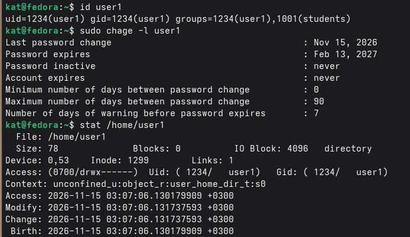
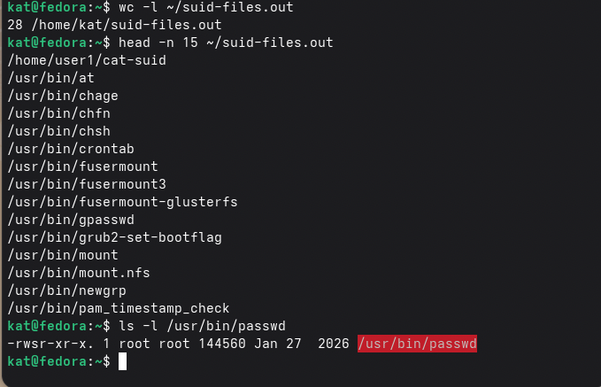
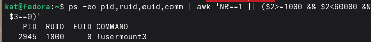
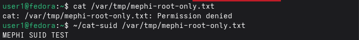
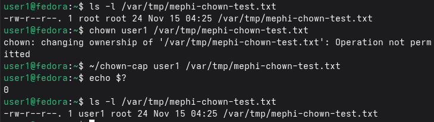
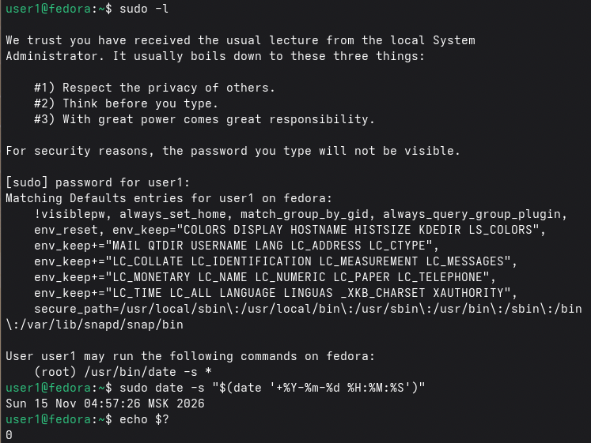
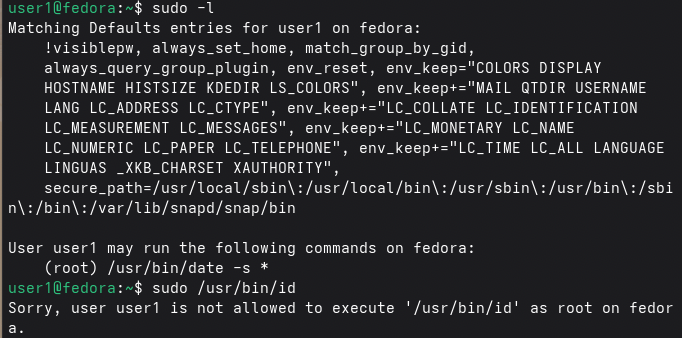
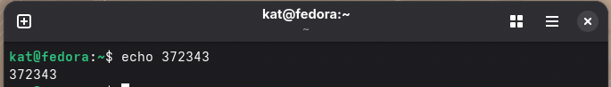
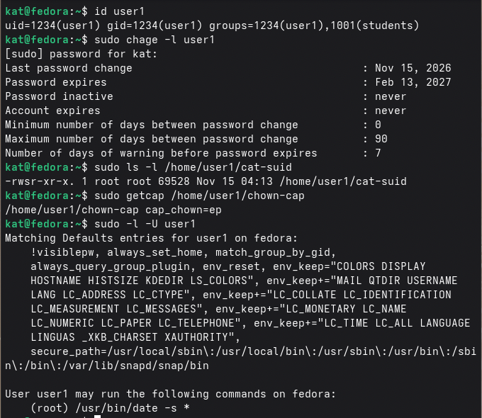

    

# Защита в операционных системах  
---
  
**Домашнее задание №1. Изучение средств защиты ОС GNU/Linux (vo_HW)**     
  
**Среда выполнения** 
  
**Операционная система:** Fedora Linux  
  
## Ход работы  
---
  
## Навигация по работе и артефактам

| Раздел | Название раздела / подраздела | Что проверяется | Файлы и скриншоты |
|:---:|---|---|---|
| **1** | [Создание пользователя](#раздел-1-создание-пользователя) | Управление пользователями и группами; права домашней директории | [passwd](artifacts/passwd), [shadow-redacted](artifacts/shadow-redacted), [group](artifacts/group), [stat.out](artifacts/stat.out), [Скриншот](artifacts/01-user-setup.png) |
| **2.1** | [Поиск файлов с set-UID](#21-поиск-файлов-с-set-uid) | Поиск файлов | [suid-files.out](artifacts/suid-files.out), [Скриншот](artifacts/02-suid-files.png) |
| **2.2** | [Мониторинг процессов](#22-мониторинг-процессов) | Мониторинг процессов | [processes.out](artifacts/processes.out), [Скриншот](artifacts/03-process-monitoring.png) |
| **3** | [Механизм set-UID](#3-изучение-механизма-set-uid) | Установка прав доступа на утилиту | [stat.out](artifacts/stat.out), [Скриншот](artifacts/04-suid-test.png) |
| **4** | [Linux capabilities](#4-изучение-linux-capabilities) | Настройка привилегий и прав утилиты | [stat.out](artifacts/stat.out), [getcap.out](artifacts/getcap.out), [Скриншот](artifacts/05-capabilities-test.png) |
| **5** | [Механизм sudo](#5-изучение-механизма-sudo) | Настройка sudo | [sudoers](artifacts/sudoers), [sudo-rule.out](artifacts/sudo-rule.out), [sudo-permissions.out](artifacts/sudo-permissions.out), [Скриншот 1](artifacts/06-sudo-test.png), [Скриншот 2](artifacts/06-sudo-restriction.png) |
| **6** | [Сбор артефактов](#6-сбор-артефактов) | Визуальное подтверждение | [mephi-screenshot.png](artifacts/mephi-screenshot.png), [Проверка после перезагрузки](artifacts/07-persistence-check.png) |
| **Все** | **История выполнения работы** | Выполненные команды | [history.out](artifacts/history.out) |
  
---  
  
## Раздел 1. Создание пользователя  
  
Созданный пользователь `user1` с UID `1234`, `user1` добавлен в группу `students`.  
Необходимость изменения пароля `user1` каждые три месяцана настроена.  
  
```bash
sudo groupadd students
sudo useradd -m -u 1234 -G students user1
sudo passwd user1
sudo chage -M 90 user1
```  
    
  
  
## 2. Мониторинг файлов и процессов  
  
### 2.1. Поиск файлов с set-UID  
  
Поиск всех файлов с установленым set-UID: 
   
```bash
sudo find / -type f -perm -4000 2>/dev/null | sort | tee ~/suid-files.out
```  
  
Обнаружено 28 файлов с установленным set-UID, включая созданный `cat-suid` [Список SUID-файлов](artifacts/suid-files.out)  
  
  
  
### 2.2. Мониторинг процессов  
  
```bash
ps -eo pid,ruid,euid,comm | awk 'NR==1 || ($2>=1000 && $2<60000 && $3==0)'
```  
[Файл мониторинга процессов](artifacts/processes.out)  
  
Обнаружен процесс `fusermount3`, у процесса реальный UID равен `1000`, а эффективный UID — `0`:  
     
  
  
## 3. Изучение механизма set-UID   
  
Используется утилита `cat`, привилегированная операция с set-UID выполнена:  
   
```bash
sudo cp /usr/bin/cat /home/user1/cat-suid
sudo chown root:root /home/user1/cat-suid
sudo chmod 4755 /home/user1/cat-suid
```  
  
  
  
## 4. Изучение Linux capabilities  
   
Используется утилита `chown` и привилегия `CAP_CHOWN`:  
  
```bash
sudo cp /usr/bin/chown /home/user1/chown-cap
sudo chown root:root /home/user1/chown-cap
sudo chmod 755 /home/user1/chown-cap
sudo setcap cap_chown=ep /home/user1/chown-cap
```  
[Результат getcap](artifacts/getcap.out)  
  
Операция выполняется успешно:  
  
  
  
## 5. Изучение механизма sudo  
  
```text
user1 ALL=(root) /usr/bin/date -s *
```  
  
  
  
  
## 6. Сбор артефактов  
  
  
  
  
P.S. Дополнительно представлены системные конфигурационные файлы.  
В публичной копии `/etc/shadow` хеши паролей скрыты в целях безопасности.  
